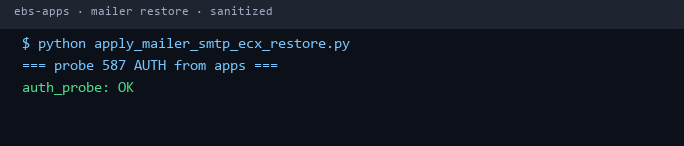
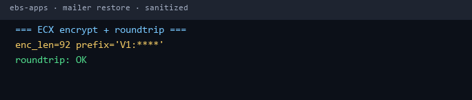
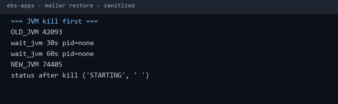
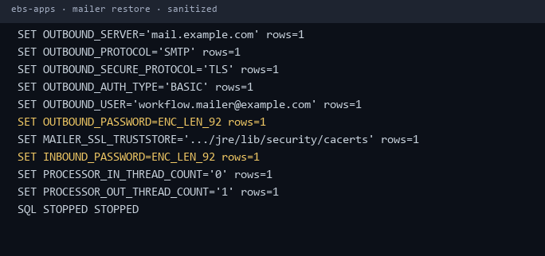
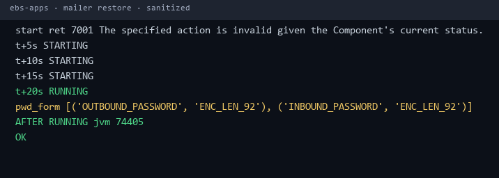
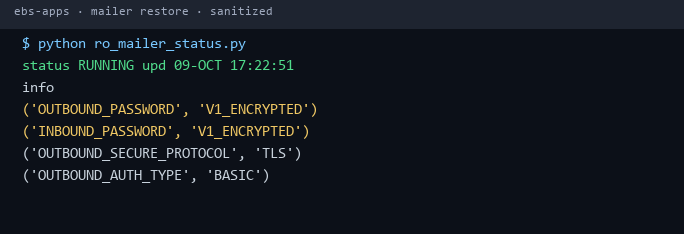

# Cookbook — Workflow Mailer SMTP 587/TLS + ECX `V1:` Password Restore (Oct 2026)

**Achievement:** Restored Oracle EBS Workflow Notification Mailer after mailbox AUTH failure, and cleared Outlook **"Unable to validate access to Notification"** on new PR Action Required emails — without Path-B / template surgery.

All hosts, users, and passwords below are **dummy / env placeholders**. Never commit real secrets.

---

## Symptoms

1. Component **WF Notification Mailer** (`component_id` from env, example `10006`) → `DEACTIVATED_SYSTEM` / `STOPPED_ERROR` / not delivering.
2. Mailcow / SMTP mailbox password rotated or broken → AUTH fail on submission.
3. Pasting **plaintext** into `OUTBOUND_PASSWORD` / `INBOUND_PASSWORD` → Java mailer fails decrypt (`SecurityUtils.decrypt` → `ECX_OBFUSCATE`) → still unable to connect.
4. Side effect when mailer JVM is healthy again: inline PR body (FWK_RN path) renders → **Unable** disappears on **new** notifications.

---

## Root cause chain

```text
Mailbox AUTH break
  → SMTP connect fail
  → mailer DEACTIVATED_SYSTEM

Plaintext password written to fnd_svc_comp_param_vals
  → SecurityUtils.decrypt expects V1:… (ECX_OBFUSCATE)
  → decrypt / connect fail

Correct path = SMTP submission port 587 + STARTTLS + BASIC AUTH
  (not anonymous :25)
```

Discovery (sanitized):

```bash
# On apps tier — class that encrypts/decrypts mailer passwords
javap -c -classpath "$JAVA_TOP:$AF_CLASSPATH" \
  oracle.apps.fnd.wf.mailer.SMTPUtils | grep -i encrypt

# Result (sanitized):
# invokestatic ... SecurityUtils.encrypt:(Ljava/sql/Connection;Ljava/lang/String;)...
# String Failed to Encrypt the Outbound password

javap -private -classpath "$JAVA_TOP:$AF_CLASSPATH" \
  oracle.apps.fnd.cp.gsc.SecurityUtils | head

# strings showed callable:
# { CALL ECX_OBFUSCATE.ECX_DATA_ENCRYPT ( l_input_string => :1, ... ) }
# decrypt uses same package with l_qual_code => 'D'
```

---

## Environment (copy `.env.example`)

```bash
export EBS_DB_DSN='ebs-db.example.local:1521/PROD'
export APPS_USER='APPS'
export APPS_PWD='***'                    # never commit
export PROD_APPS_SSH='oracle@ebs-apps.example.local'
export MAIL_HOST='mail.example.com'
export MAIL_USER='workflow.mailer@example.com'
export MAIL_PWD='***'                    # never commit
export MAILER_SSL_TRUSTSTORE='/u01/oracle/EBS/fs2/EBSapps/comn/util/jdk64/jre/lib/security/cacerts'
export HTMLAGENT='http://ebs-apps.example.local:8000/'
export WF_MAILER_COMPONENT_ID='10006'
export WFMLR_QUEUE_ID='1140'
export ORACLE_CLIENT_LIB='C:\oracle\instantclient_21_3'   # Windows client example
```

---

## Step 0 — AUTH probe from apps tier (must be OK first)

```bash
# Build AUTH PLAIN blob offline (do not echo password in shell history)
python - <<'PY'
import base64, os
u, p = os.environ["MAIL_USER"], os.environ["MAIL_PWD"]
print(base64.b64encode(b"\0"+u.encode()+b"\0"+p.encode()).decode())
PY

# On apps host via SSH:
{ sleep 1; echo EHLO ebs-apps; sleep 1;
  echo 'AUTH PLAIN <blob>'; sleep 1; echo QUIT; } |
  timeout 20 openssl s_client -connect mail.example.com:587 \
  -starttls smtp -quiet 2>/dev/null | tail -20
```

**Actual session result (sanitized):**

```text
auth_probe: OK
```



---

## Step 1 — Encrypt password with `ECX_OBFUSCATE` (never store plaintext)

```sql
-- SQL*Plus / Python oracledb as APPS
VARIABLE out VARCHAR2(4000)
VARIABLE err VARCHAR2(4000)
VARIABLE ret NUMBER
BEGIN
  apps.ecx_obfuscate.ecx_data_encrypt(
    l_input_string  => :mail_pwd,   -- bind, do not log
    l_output_string => :out,
    errmsg          => :err,
    retcode         => :ret);
END;
/
-- Expect retcode 0 and output starting with V1:
```

Decrypt check (same API, `l_qual_code => 'D'`):

```sql
BEGIN
  apps.ecx_obfuscate.ecx_data_encrypt(
    l_input_string  => :cipher,
    l_qual_code     => 'D',
    l_output_string => :plain,
    errmsg          => :err,
    retcode         => :ret);
END;
/
```

**Actual session result (sanitized):**

```text
=== ECX encrypt + roundtrip ===
enc_len=92 prefix='V1:****'
roundtrip: OK
```



---

## Step 2 — JVM-first bounce (queue container)

Component API stop alone can hang in `STARTING`. Kill the real Java PID for conc queue `WFMLR_QUEUE_ID` first.

```bash
ssh oracle@ebs-apps.example.local \
  "ps -eo pid,args | awk '/[c]onc_queue_id=1140/ && /GSMSvcComponentContainer/ {print \$1; exit}'"
# OLD_JVM <pid>
ssh oracle@ebs-apps.example.local "kill -TERM <pid>"
# wait until NEW_JVM appears (PID changed)
```

**Actual session result (sanitized):**

```text
=== JVM kill first ===
OLD_JVM 42093
wait_jvm 30s pid=none
wait_jvm 60s pid=none
NEW_JVM 74405
status after kill ('STARTING', ' ')
```



---

## Step 3 — Set mailer params (encrypted passwords)

Key params (values are examples):

| Parameter | Value |
|-----------|--------|
| `OUTBOUND_SERVER` | `mail.example.com` |
| `OUTBOUND_PROTOCOL` | `SMTP` |
| `OUTBOUND_SECURE_PROTOCOL` | `TLS` |
| `OUTBOUND_AUTH_TYPE` | `BASIC` |
| `OUTBOUND_USER` | `workflow.mailer@example.com` |
| `OUTBOUND_PASSWORD` | `V1:…` (ECX ciphertext only) |
| `MAILER_SSL_TRUSTSTORE` | JDK `cacerts` path |
| `INBOUND_PASSWORD` | same `V1:…` |
| `PROCESSOR_IN_THREAD_COUNT` | `0` (outbound-only start) |
| `PROCESSOR_OUT_THREAD_COUNT` | `1` |

**Actual session result (sanitized):**

```text
SET OUTBOUND_SECURE_PROTOCOL='TLS' rows=1
SET OUTBOUND_AUTH_TYPE='BASIC' rows=1
SET OUTBOUND_PASSWORD=ENC_LEN_92 rows=1
SET INBOUND_PASSWORD=ENC_LEN_92 rows=1
SET PROCESSOR_IN_THREAD_COUNT='0' rows=1
SQL STOPPED STOPPED
```



---

## Step 4 — Start component + watch until RUNNING

```sql
BEGIN
  fnd_global.apps_initialize(0,20420,1);
  apps.fnd_svc_component.start_component(
    p_component_id => :cid,   -- e.g. 10006
    p_retcode      => :r,
    p_errbuf       => :e);
END;
/

SELECT component_status, component_status_info
  FROM apps.fnd_svc_components
 WHERE component_id = :cid;
```

**Actual session result (sanitized):**

```text
start ret 7001 The specified action is invalid given the Component's current status.
t+5s STARTING
t+10s STARTING
t+15s STARTING
t+20s RUNNING
pwd_form [('OUTBOUND_PASSWORD', 'ENC_LEN_92'), ('INBOUND_PASSWORD', 'ENC_LEN_92')]
AFTER RUNNING jvm 74405
OK
```

Note: `7001` can appear if monitor already moved status; final state **RUNNING** is what matters.



---

## Step 5 — RO verify

```text
$ python ro_mailer_status.py
status RUNNING upd 09-OCT 17:22:51
('OUTBOUND_PASSWORD', 'V1_ENCRYPTED')
('INBOUND_PASSWORD', 'V1_ENCRYPTED')
('OUTBOUND_SECURE_PROTOCOL', 'TLS')
('OUTBOUND_AUTH_TYPE', 'BASIC')
```



---

## Business proof

- New Purchase Requisition **Action Required** email delivered from Workflow Mailer.
- Outlook showed full Requisition Lines + Approval Sequence + Action History + `Notification Detail.html`.
- **"Unable to validate access to Notification"** cleared on new mail (fresh healthy mailer JVM + working SMTP).

*(Do not publish real PR numbers, employee names, or amounts on LinkedIn — redact screenshots.)*

---

## One-liner run

```bash
# after filling .env
python scripts/apply_mailer_smtp_ecx_restore.py
```

---

## What we did NOT do (on purpose)

- Path B / swap BODY to `&PO_REQ_APPROVE_MSG` — **cancelled / dead**
- Anonymous SMTP `:25` — rejected (AUTH unsupported on our Mailcow path)
- Leaving plaintext passwords in `fnd_svc_comp_param_vals`
- Re-enabling inbound IMAP threads before outbound was stable

---

## Next-time playbook (locked)

If **"Unable to validate"** **or** mailer down / no WF mail:

1. Apps → `:587` AUTH probe  
2. Fix mailbox password if needed → **ECX encrypt** → store `V1:` only  
3. TLS / 587 / BASIC + cacerts + inbound threads `0`  
4. JVM-first bounce → start component  
5. Prove with a **new** AR email  

---

## Security

- No real passwords, IPs, or mailbox names in this repo  
- Use `.env` locally; `.env` is gitignored  
- Rotate any credential that ever appeared in chat or screenshots  
